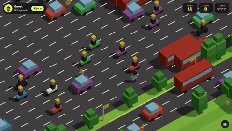

# Lagos Crossing

A hop-across-the-road game for [start.ng](https://start.ng). Your start.ng character hops across the roads of Lagos, dodging danfos, okadas, BRT buses and the train, picking up naira coins on the way. Stand still too long or fall too far behind and the agbero catches you.

Play it at **https://lagos-crossing.start.ng**

## Demo



Full demo video (52 s): [docs/lagos-crossing-demo.mp4](docs/lagos-crossing-demo.mp4)

## How to play

- **Arrow keys** or **WASD** to hop. On a phone, swipe, tap to hop forward, or use the on-screen pad.
- Every row you cross is a point. Coins are a tie-breaker on the leaderboard.
- Roads carry traffic in one direction per lane. Rail lines flash a red light before the train comes.
- Trees block the way. You cannot hop off the sides of the road.

## start.ng

- The game asks start.ng who is playing and dresses the character in the player's own body, colours, hair, hat and accessory, so you look the same here as everywhere else on start.ng. Guests get the default look and a sign-in button.
- Scores are saved to the shared leaderboard for signed-in players: rows crossed first, coins second (`startng.json`).
- Opened as a local file or outside start.ng the game still plays; it just has no player or leaderboard.

## Built with

Plain HTML, CSS and JavaScript with [three.js](https://threejs.org) loaded from jsDelivr. No build step: open `index.html` from any static server.

```
python -m http.server 8080
# then open http://localhost:8080
```

## Files

| File | What it is |
| --- | --- |
| `index.html` | The page, HUD and menus |
| `src/game.js` | World, traffic, player, camera, input, scoring |
| `src/character.js` | The start.ng character, built from a player's style |
| `src/startng.js` | Talking to start.ng (who is playing, save a run, leaderboard) |
| `src/styles.css` | Styles |
| `startng.json` | Leaderboard columns |
| `cover.png` | The card picture on start.ng |

Made by Bayode Manuel for HNG15, Team Vulcan.
